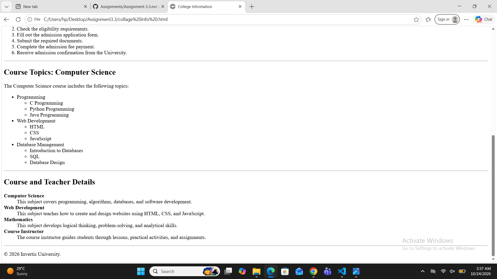

# Assignment 3.3 — Ordered, Unordered & Nested Lists

## 1. Aim

The aim of this assignment is to learn how to create and organize different types of lists in HTML, including ordered lists, unordered lists, nested lists, and description lists, to present information about a college or course.

## 2. Introduction

HTML (HyperText Markup Language) is used to structure content on webpages. Lists are an important HTML feature that helps organize information in a clear, readable, and systematic manner. In this assignment, a college or course information webpage is created using different HTML list elements, headings, and sections.

## 3. Theory

HTML provides three main types of lists:

### A. Unordered List (`<ul>`)

An unordered list displays a collection of items using bullet points. It is useful when the order of items is not important.

For example, a college webpage can use an unordered list to display the names of departments, available subjects, or facilities.

### B. Ordered List (`<ol>`)

An ordered list displays items in a specific sequence, usually using numbers or letters. It is useful when the order of steps is important.

For example, the admission process can be presented as a numbered list, showing each step from filling out the application form to completing admission.

### C. Nested List

A nested list is a list placed inside another list. It is used to organize information into main topics and subtopics.

For example, a subject may contain several units, and each unit may include multiple topics. Nested lists make such information easier to understand and navigate.

### D. Description List (`<dl>`)

A description list is used to display terms and their corresponding descriptions. It is useful for presenting details about teachers, courses, or academic programs.

It uses three HTML tags:

- `<dl>`: Defines the description list.
- `<dt>`: Specifies the term or name being described.
- `<dd>`: Provides the description or details of that term.

For example, a course name can be followed by its duration, eligibility requirements, and other relevant information.

## 4. Headings and Sections

HTML headings, such as `<h1>`, `<h2>`, and `<h3>`, are used to define titles and subtitles on a webpage. They create a clear content hierarchy.

The `<section>` element groups related content into meaningful sections, such as college introduction, departments, admission process, and course details. These elements improve the organization and readability of the webpage.

## 5. Importance of HTML Lists

1. Lists organize information systematically.
2. They improve the readability of webpage content.
3. Ordered lists clearly present sequential steps.
4. Nested lists help explain complex information through subtopics.
5. Description lists present terms and their explanations effectively.
6. Lists make college and course information easier for users to understand.

## 6. Applications

HTML lists can be used in various types of websites, including:

- College and university websites.
- Online course and educational portals.
- Admission and registration pages.
- Teacher and faculty information pages.
- Tutorials and study materials.

## 7. Testing and Verification

## SCREENSHOTS

## 8. Conclusion

In this assignment, I learned how to use different types of HTML lists to organize information about a college or course. I understood the use of unordered lists (`<ul>`), ordered lists (`<ol>`), nested lists, and description lists (`<dl>`, `<dt>`, and `<dd>`). I also learned how headings and sections help structure webpage content. This assignment improved my understanding of HTML elements and their role in creating well-organized and user-friendly webpages.